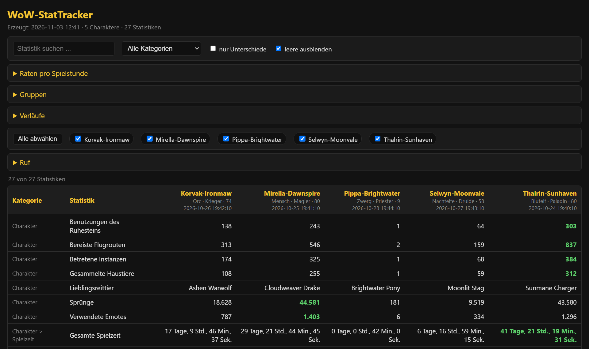
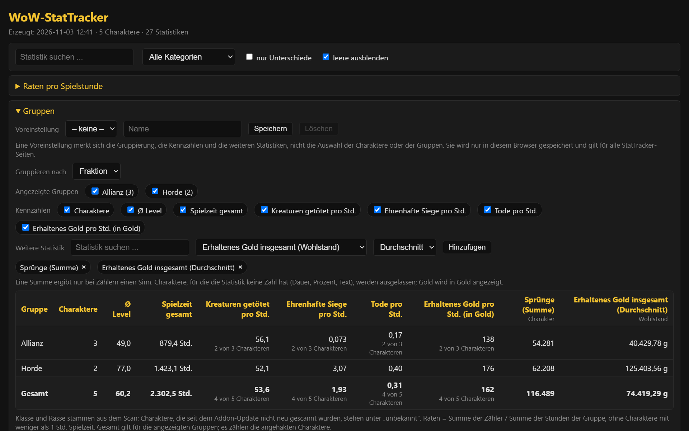
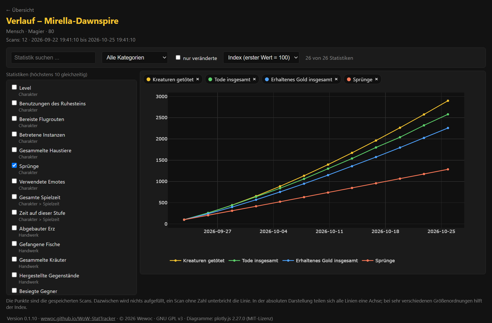
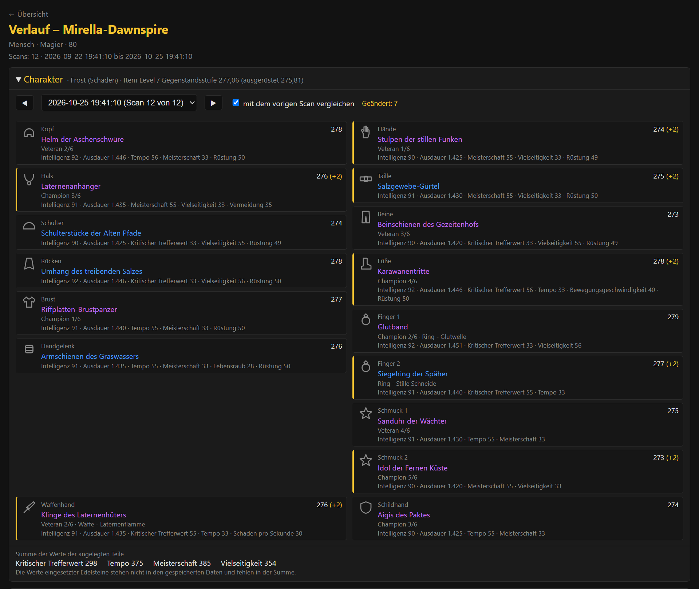
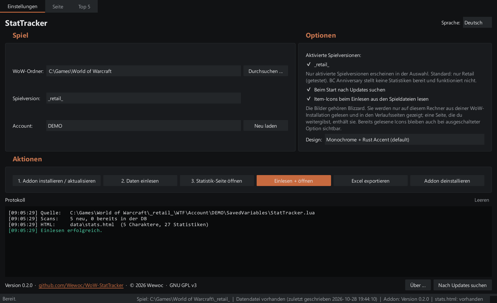
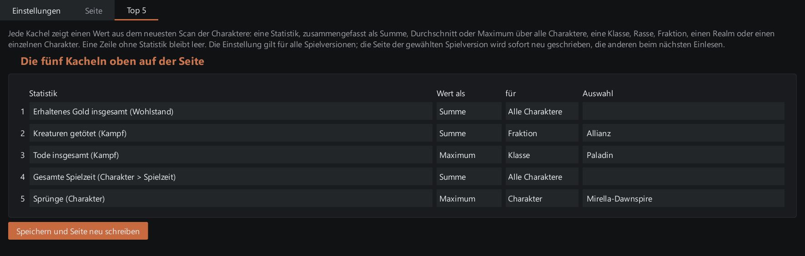

# StatTracker

[English](README.md)

StatTracker liest die **Spielstatistiken** deiner World-of-Warcraft-Charaktere über ein kleines Addon aus, speichert jeden Scan in einer lokalen Datenbank (mit Historie) und lässt dich deine **Charaktere vergleichen** - auf einer Seite im Programmfenster (oder im Browser geöffnet) oder in einer Excel-Datei. Alles bleibt auf deinem Rechner.



- Windows-Programm mit eigenem Fenster: Die Statistik-Seite wird darin gezeigt, ein Browser muss nicht eingerichtet werden; deutsche und englische Oberfläche, sechs Farbschemata
- **Top 5**: fünf Kacheln oben auf der Seite, jede mit einem Wert, den du wählst (eine Statistik, zusammengefasst für alle Charaktere, eine Klasse, Rasse, Fraktion, einen Realm oder einen einzelnen Charakter)
- Raten pro Spielstunde (Kills, Tode, Gold) je Charakter und insgesamt; lässt sich eine Zahl nicht berechnen, nennt die Seite den Grund
- Gruppiert deine Charaktere nach Klasse, Rasse, Fraktion oder Realm
- Eine Verlaufsseite für jeden Charakter mit mindestens zwei Scans: Statistiken auswählen und als Linien über deine Scans ansehen
- Arbeitet pro Spielversion; standardmäßig ist nur **Retail** aktiviert

## Schnellstart (Release-Download)

1. `StatTracker.zip` aus dem neuesten Release laden und in **einen eigenen Ordner** entpacken, zum Beispiel `Dokumente\StatTracker`. Nicht nach `C:\Program Files`: Das Programm legt seine Daten neben sich ab und braucht Schreibrechte. Der Download ist etwa 160 MB groß, weil das Programm seine eigene Browser-Engine für die Seite mitbringt.
2. `StatTracker.exe` starten. Windows SmartScreen warnt eventuell, weil die Datei nicht signiert ist: *Weitere Informationen -> Trotzdem ausführen*.
3. **WoW-Ordner** wählen (der Ordner, der `_retail_` enthält), dazu Spielversion und Account.
4. **1. Addon installieren / aktualisieren**.
5. Im Spiel, einmal pro Charakter: `/statscan`. Der Scan dauert etwa 10 Sekunden (gestreckt, damit das Spiel nicht einfriert): Im Chat erscheinen „Stat-Sync gestartet“, dann „Stat-Sync fertig“ und „Spielzeit ... erfasst“. Darauf warten, dann `/reload` (oder ausloggen). Das Addon scannt auch automatisch 10 Sekunden nach dem Einloggen.
6. **2. Daten einlesen**, dann **3. Statistik-Seite öffnen** (sie erscheint im Reiter *Seite* des Fensters) - oder **Excel exportieren**.

Schritt 5/6 wiederholen, wenn du frische Zahlen willst. Eingelesene Scans bleiben in der Datenbank. Das Addon selbst behält die letzten fünf Scans je Charakter: Ein Scan geht nur verloren, wenn zwischen zwei Einlesungen mehr als fünf gemacht wurden (das Protokoll sagt, wenn Scans fehlen können) - lies die Daten nach jeder Spielsitzung ein, wenn dir der Verlauf wichtig ist. Jeder WoW-Account hat eine eigene Datei; wähle den Account im Programm (das Protokoll nennt die anderen Accounts mit Daten).

Das Addon speichert bei jedem Scan auch die Klasse (als sprachunabhängigen Namen) und die Rasse des Charakters. Scans eines älteren Addons haben diese Angaben nicht, sie werden nie nachgetragen: Solche Charaktere stehen im Gruppen-Block bei Klasse und Rasse unter „unbekannt“ - es wird nichts geraten. *1. Addon installieren / aktualisieren* ausführen und den Charakter erneut scannen, um sie zu bekommen.

Jeder Scan speichert außerdem die Spezialisierung, das durchschnittliche Itemlevel, die angelegte Ausrüstung (mit Verzauberung, Aufwertungsstufe und Sockeln) und die Rufliste; sie liegen in der Datenbank. Die Ausrüstung zeigt die Verlaufsseite des Charakters (unten), den Ruf der ausklappbare Block *Ruf* der Statistik-Seite; er listet jede Fraktion der angehakten Charaktere in der Reihenfolge des Spiels mit Stufe und einem Balken zur nächsten Stufe (Freundschaften, Ruhm und Paragon inklusive; kontoweiter Ruf steht einmal). Scans eines älteren Addons haben nichts davon und es wird nie nachgetragen: Solche Charaktere stehen unter dem Block als „ohne Rufdaten“ - mit dem aktualisierten Addon erneut scannen.

Die Statistik-Seite zeigt Rasse, Klasse und Level unter jedem Namen. Ihr ausklappbarer Block *Gruppen* fasst die angehakten Charaktere nach Klasse, Rasse, Fraktion oder Realm zusammen: Anzahl, Durchschnittslevel, Spielzeit und die Raten pro Stunde. Jede weitere Statistik mit Zahl lässt sich als Spalte hinzufügen (Summe, Durchschnitt oder Maximum). Eine Voreinstellung speichert Gruppierung, Kennzahlen und hinzugefügte Statistiken unter einem Namen; sie liegt in den Einstellungen des Programms (`data/config.json`), nicht in der Seite. Der Excel-Export hat keine Gruppen.



Jeder Charakter mit mindestens zwei Scans bekommt außerdem eine **Verlaufsseite**, verlinkt im Block *Verläufe* der Statistik-Seite: bis zu zehn Statistiken auswählen und als Linien über deine Scans ansehen, absolut oder als Index (erster Wert = 100). Ein Scan ohne Zahl hinterlässt eine Lücke, es wird nichts aufgefüllt. *2. Daten einlesen* erzeugt die Seiten (für Charaktere mit neuem Scan oder neuen Item-Bildern) und braucht kein Internet; die Links funktionieren, solange der Ordner `history` neben der Statistik-Seite liegt.

Zwei weitere Linien stehen dort zur Wahl: das ausgerüstete und das gesamte Itemlevel (Gegenstandsstufe) jedes Scans (das gesamte nimmt für jeden Slot das beste Teil, das der Charakter bei sich hat; es liegt höher, wenn in den Taschen ein besseres Teil wartet). Über dem Diagramm zeigt der ausklappbare Bereich *Charakter* die Ausrüstung eines Scans, angeordnet wie der Charakterbildschirm des Spiels: je Slot das Teil mit Itemlevel, Aufwertungsspur, Verzauberung, Werten und einem Hinweis auf einen leeren Edelsteinsockel, dazu die Summe der Zweitwerte (die Werte eingesetzter Edelsteine stehen nicht in den gespeicherten Daten und sind nicht enthalten). Jeder Scan lässt sich wählen und mit dem vorigen vergleichen; geänderte Slots sind markiert. Hemd und Wappenrock fehlen.





Die Slots zeigen die Item-Bilder des Spiels, wenn StatTracker sie hat. Beim Einlesen der Daten sucht es die Bilder der Gegenstände, die deine Charaktere getragen haben, in den Spieldateien deiner WoW-Installation (nur lesend, das Spiel darf laufen), legt jedes als kleine PNG-Datei in `data/icons` ab und bettet sie in die Verlaufsseiten ein; wo ein Bild fehlt, bleibt das Symbol des Slots. Gelesen werden nur die Bilder, die noch fehlen: Das erste Einlesen dauert einige Sekunden länger, spätere kaum; das Programm stellt dafür keine Netzwerkanfrage. Die Option *Item-Icons beim Einlesen aus den Spieldateien lesen* im Reiter *Einstellungen* ist standardmäßig an; ausgeschaltet bleiben früher gelesene Bilder sichtbar. Die Bilder gehören Blizzard Entertainment: Sie entstehen auf deinem Rechner aus deiner eigenen Installation, sind nicht Teil von StatTracker, das Bild oben zeigt einige davon (© Blizzard Entertainment), und eine Verlaufsseite, die du weitergibst, enthält die Bilder, die sie zeigt.

## Das Fenster

Das Fenster hat drei Reiter. **Einstellungen** enthält Spielordner, Spielversion und Account, die Optionen (Spielversionen, Update-Prüfung, Item-Bilder, das *Design*), die Knöpfe und das Protokoll. **Seite** zeigt die Statistik-Seite im Fenster; *Neu laden* liest die Datei erneut, und *Im Browser öffnen* öffnet eine **Momentaufnahme** dessen, was das Fenster jetzt zeigt - die angehakten Charaktere, Filter, Sortierung, Gruppierung und hinzugefügte Statistiken - als Datei `stats_snapshot.html` neben der Statistik-Seite (sie wird bei jedem Klick neu geschrieben). Im Browser sind die Bedienelemente der Momentaufnahme gesperrt, weil eine Seite dort keine Verbindung zum Programm hat: Sie ist ein Stand, keine mitlaufende Kopie. **Top 5** stellt die Kacheln ein (unten).



Das *Design* bietet sechs Farbschemata; das Fenster und die Statistik-Seite folgen ihm, die Änderung gilt nach einem Neustart. Eine im Browser geöffnete Seite zeigt die ursprünglichen Farben.

## Top 5

Bis zu fünf Kacheln stehen ganz oben auf der Statistik-Seite. Jede zeigt einen Wert aus dem neuesten Scan deiner Charaktere: eine Statistik deiner Wahl, zusammengefasst als **Summe**, **Durchschnitt** oder **Maximum** über alle Charaktere, über eine Klasse, Rasse, Fraktion oder einen Realm oder für einen einzelnen Charakter. Die Kachel nennt die Statistik, die Funktion und für wen der Wert gilt, und sagt, aus wie vielen Charakteren er besteht, wenn einige keine Zahl hatten ("10 von 23 Charakteren"); wo es keine Zahl gibt, steht das da, nichts wird erfunden. Gold steht in Gold, Spielzeit in Stunden. Die Kacheln folgen nicht den angehakten Charakteren.

Eingestellt werden sie im Reiter **Top 5**: Einen Teil des Namens einer Statistik tippen und aus der Liste wählen, die sich unter dem Feld öffnet, Funktion und Bereich wählen (ein Klick ins letzte Feld öffnet dessen Liste), dann *Speichern und Seite neu schreiben*. Die Einstellung gilt für alle Spielversionen; die Seite der gewählten Spielversion wird sofort neu geschrieben, die anderen beim nächsten Einlesen. Eine Zeile ohne Statistik bleibt leer.



## Spielversionen

Im Dropdown erscheinen nur Spielversionen, die du aktiviert hast. Standard ist nur **Retail**. Im Reiter *Einstellungen* lassen sich weitere aktivieren. Jede Spielversion hat eigene Datenbank und Seite (`wow_stats.db` / `stats.html` für Retail, `wow_stats_<Version>.db` / `stats_<Version>.html` für die anderen).

| Spielversion | Stand |
|---|---|
| Retail (`_retail_`) | getestet, funktioniert |
| WoW Forever (`_forever_`) | getestet, funktioniert; noch nicht alle Statistiken sind freigeschaltet, das hängt von der Charakterstufe ab |
| BC Anniversary (`_anniversary_`) | getestet, **funktioniert nicht**: Diese Spielversion stellt keine Statistiken bereit, es gibt also nichts auszulesen |
| alle anderen | ungetestet |

Meldet WoW das Addon als veraltet: im Spiel `/dump (select(4, GetBuildInfo()))` ausführen und die Zahl in `StatTracker.toc` (`## Interface:`) eintragen. Beim Installieren setzt das Programm sie aus `.build.info` selbst.

## Deinstallieren

- **Addon:** *Addon deinstallieren* entfernt `Interface\AddOns\StatTracker` der gewählten Spielversion. Vorher wird gefragt, ob auch die vom Addon in WoW gespeicherten Daten (`StatTracker.lua` in `SavedVariables`) gelöscht werden sollen - Standard ist behalten. Deine lokale Datenbank und die Seiten löscht dieser Button nie.
- **Programm:** schließen und den Ordner löschen.

## Sprache

Die Fenstersprache stellst du oben rechts im Reiter *Einstellungen* im Dropdown ein (Deutsch / English); sie wird gemerkt. Beim ersten Start gilt deine Windows-Sprache. Die erzeugte Statistik-Seite und die Excel-Datei nutzen dieselbe Sprache.

Die **Namen der Statistiken** kommen vom WoW-Client und erscheinen in dessen Sprache - StatTracker übersetzt sie nicht.

## Updates

Beim Start (abschaltbar im Reiter *Einstellungen*) fragt StatTracker bei GitHub nach einem neueren Release. Gibt es eins, lädt *Jetzt aktualisieren* die `StatTracker.zip`, prüft sie gegen `StatTracker.zip.sha256` (ohne Prüfsumme kein Update), ersetzt **nur die Programmdateien** und startet neu. Dein Ordner `data` wird nie angefasst. Die vorherige Version bleibt in `_update_backup` und wird automatisch zurückgespielt, wenn die neue nicht startet. Die einzige Netzwerkanfrage ist diese Prüfung; sie sendet keine persönlichen Daten.

## Wo liegen meine Daten?

Neben dem Programm im Ordner `data`: `config.json`, `wow_stats*.db`, `stats*.html`, der Ordner `history` (`history_<Version>` bei den anderen Spielversionen; er lässt sich aus der Datenbank neu erzeugen), der Ordner `icons` (die aus dem Spiel gelesenen Item-Bilder, `icons_<Version>` bei den anderen Spielversionen; fehlende werden neu gelesen), der Ordner `webview` (was die Browser-Engine des Fensters ablegt; nichts, was du brauchst), `stattracker.xlsx` und der Ordner `backups`. Sichere diesen Ordner, wenn dir die Historie wichtig ist.

Bevor ein Einlesen in eine vorhandene Datenbank schreibt, kopiert StatTracker sie nach `data/backups/`:

- `daily/` enthält eine Kopie pro Tag für die letzten 7 Tage; ältere werden automatisch gelöscht.
- `migration/` enthält eine Kopie vor jedem Datenbank-Upgrade (der Dateiname nennt die Version, zu der es führt). Diese werden nie automatisch gelöscht; lösche sie von Hand, wenn du sie nicht mehr brauchst.

So stellst du eine Kopie wieder her: StatTracker schließen, eine `.bak`-Datei aus dem Ordner kopieren, in `wow_stats.db` umbenennen (`wow_stats_<Version>.db` bei den anderen Spielversionen) und in `data` legen. Die Kopien liegen auf derselben Platte wie die Datenbank: sie schützen vor einem fehlerhaften Einlesen oder Upgrade, nicht vor einer defekten Platte - sichere `data` zusätzlich an anderer Stelle. Lässt sich eine Kopie nicht schreiben, bricht das Einlesen ab und ändert nichts. Vor jeder Kopie bekommt die Datenbank eine schnelle Integritätsprüfung; fällt sie durch, bricht das Einlesen ebenfalls ab, damit eine beschädigte Datenbank nicht über deine guten Kopien kopiert wird - spiele dann eine Kopie zurück, wie oben beschrieben.

## Aus dem Quellcode starten

Python 3.10+ (das Fenster nutzt PyQt6, das die Zeile unten installiert):

```bash
pip install -r requirements.txt
python src/start.py
```

Ohne `src/CascLib.dll` läuft das Programm, liest aber keine Item-Bilder; wie man sie baut, steht in [docs/DEVELOPMENT.md](docs/DEVELOPMENT.md), dort steht auch mehr.

## Haftungsausschluss

Diese Software wird **„wie besehen“ (as is)** bereitgestellt, ohne Gewährleistung jeglicher Art, weder ausdrücklich noch stillschweigend. **Die Nutzung erfolgt auf eigenes Risiko.** Der Autor haftet nicht für Schäden oder Verluste, die aus der Nutzung entstehen, darunter verlorene oder beschädigte Daten, Probleme mit deiner Spielinstallation oder deinem Account oder Folgen nach den Nutzungsbedingungen des Spiels, deren Einhaltung in deiner Verantwortung liegt.

StatTracker installiert und entfernt Dateien in deinem WoW-Ordner, ersetzt beim Selbst-Update seine eigenen Programmdateien und legt neben sich eine Datenbank an - sichere, was dir wichtig ist (zum Beispiel den Ordner `data`). Siehe Abschnitte 15 bis 17 der [LICENSE](LICENSE) (Gewährleistungsausschluss, Haftungsbeschränkung).

## Lizenz

Copyright (C) 2026 Wewoc. GNU General Public License v3.0 oder neuer - siehe [LICENSE](LICENSE). Dies ist ein Fan-Werkzeug; World of Warcraft ist eine Marke von Blizzard Entertainment, die mit diesem Projekt nicht verbunden ist.

Software von Dritten: Die Verlaufsseiten enthalten [plotly.js](https://github.com/plotly/plotly.js) 2.27.0, Copyright 2012-2023 Plotly, Inc., MIT-Lizenz. Sie ist nicht Teil dieses Repositorys: Der Build lädt sie einmal herunter und prüft sie gegen eine feste SHA-256-Summe, der Lizenzhinweis bleibt im Kopf der eingebetteten Datei. Die Seiten stellen keine Netzwerkanfragen.

CascLib von Ladislav Zezula (MIT-Lizenz, <https://github.com/ladislav-zezula/CascLib>) liest die Spieldateien für die Item-Bilder: Der Build holt ihren Quelltext bei einem festen Commit von GitHub und baut daraus `CascLib.dll`, die zum Programm gehört. Der Lizenztext steht in [THIRD_PARTY_LICENSES.md](THIRD_PARTY_LICENSES.md) (im Ordner `info` des Releases).

Das Fenster ist mit [PyQt6](https://www.riverbankcomputing.com/software/pyqt/) (GPL v3) gebaut und zeigt die Seiten mit der Browser-Engine Qt WebEngine (Qt 6 unter der LGPL v3, auf Chromium aufbauend); beides gehört zum Release, darum ist das Programm größer als früher. Hinweise, Lizenztexte (`LICENSE-LGPL-3.0.txt`) und wo der Quelltext von Qt zu finden ist, stehen in [THIRD_PARTY_LICENSES.md](THIRD_PARTY_LICENSES.md), die auch Python, PyInstaller und openpyxl nennt.
