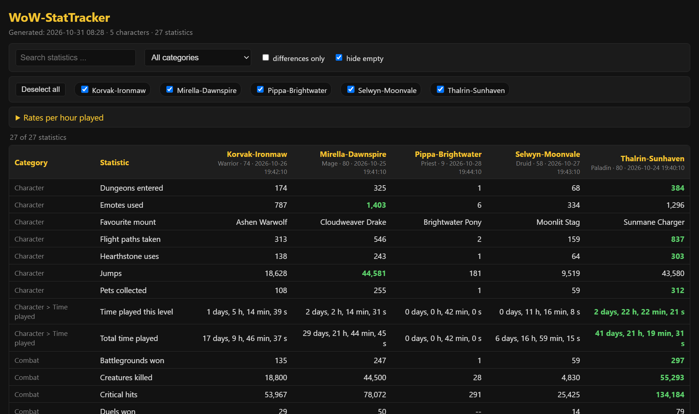
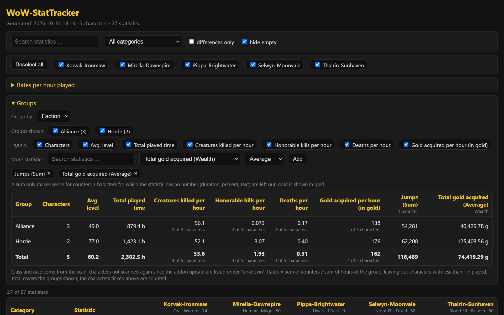

# StatTracker

[Deutsch](README.de.md)

StatTracker reads the **game statistics** of your World of Warcraft characters through a small addon, keeps every scan in a local database (with history) and lets you **compare your characters** on a page in your browser or in an Excel file. Everything stays on your computer.



- Windows program with a small window, English and German interface
- Rates per hour played (kills, deaths, gold) for each character and as a total; if a number cannot be worked out, the page says why
- Groups your characters by class, race, faction or realm
- Works per game version; by default only **Retail** is enabled

## Quick start (release download)

1. Download `StatTracker.zip` from the latest release and unpack it into **your own folder**, for example `Documents\StatTracker`. Do not use `C:\Program Files`: the program keeps its data next to itself and needs write access.
2. Start `StatTracker.exe`. Windows SmartScreen may warn because the file is not code-signed: *More info -> Run anyway*.
3. Choose your **WoW folder** (the folder that contains `_retail_`), the game version and the account.
4. **1. Install / update addon**.
5. In game, once per character: `/statscan`. The scan takes about 10 seconds (spread out so the game does not freeze): chat shows "Stat sync started", then "Stat sync done" and "Played time ... recorded". Wait for that, then `/reload` (or log out). The addon also scans automatically 10 seconds after login.
6. **2. Read data**, then **3. Open stats page** - or **Export to Excel**.

Repeat step 5/6 whenever you want fresh numbers. Old scans stay in the database.

The addon also records each character's class (as a language-independent name) and race with every scan. Scans taken with an older addon lack this data and it is never filled in afterwards: those characters are listed under "unknown" for class and race in the Groups block - nothing is guessed. Run *1. Install / update addon* and scan the character again to get it.

The stats page shows race, class and level under each name. Its collapsible *Groups* block sums up the characters ticked above by class, race, faction or realm: number of characters, average level, played time and the rates per hour. Any other statistic with a number can be added as a column (sum, average or maximum). A preset saves the grouping, the figures and the added statistics under a name; it is kept in your browser, not in the page. The Excel export has no groups.



## Game versions

Only game versions you enabled show up in the dropdown. The default is **Retail** only. Open *Settings ...* to enable others. Every game version gets its own database and page (`wow_stats.db` / `stats.html` for Retail, `wow_stats_<version>.db` / `stats_<version>.html` for the others).

| Game version | Status |
|---|---|
| Retail (`_retail_`) | tested, works |
| BC Anniversary (`_anniversary_`) | tested, **does not work**: this game version provides no statistics, so there is nothing to read |
| all others | untested |

If WoW reports the addon as outdated: in game run `/dump (select(4, GetBuildInfo()))` and put the number into `StatTracker.toc` (`## Interface:`). The program sets it for you from `.build.info` when it installs the addon.

## Uninstall

- **Addon:** *Uninstall addon* removes `Interface\AddOns\StatTracker` of the selected game version. It asks before it also deletes the data the addon stored inside WoW (`StatTracker.lua` in `SavedVariables`) - default is to keep it. Your local database and pages are never deleted by this button.
- **Program:** close it and delete its folder.

## Language

The window language is the dropdown at the top right (German / English), remembered between starts; the first start follows your Windows language. The generated stats page and Excel file use the same language.

The **names of the statistics** come from the WoW client and are shown in the client's language - they are not translated by StatTracker.

## Updates

At start (switch off in *Settings ...*) StatTracker asks GitHub whether a newer release exists. If so, *Update now* downloads `StatTracker.zip`, verifies it against `StatTracker.zip.sha256` (no checksum, no update), replaces **only the program files** and restarts. Your `data` folder is never touched. The previous version is kept in `_update_backup` and restored automatically if the new one does not start. The only network request is this check; it sends no personal data.

## Where is my data?

Next to the program, in the `data` folder: `config.json`, `wow_stats*.db`, `stats*.html`, `stattracker.xlsx` and the `backups` folder. Back that folder up if you care about the history.

Before an import writes to an existing database, StatTracker copies it into `data/backups/`:

- `daily/` holds one copy per day for the last 7 days; older ones are deleted automatically.
- `migration/` holds one copy before every database upgrade (the file name says which version it leads to). These are never deleted automatically; delete them by hand once you no longer need them.

To restore a copy: close StatTracker, copy a `.bak` file out of the folder, rename it to `wow_stats.db` (`wow_stats_<version>.db` for the other game versions) and put it into `data`. The copies lie on the same disk as the database: they protect against a faulty import or upgrade, not against a failing disk, so keep a backup of `data` somewhere else as well. If a copy cannot be written, the import stops and changes nothing.

## Run from source

Python 3.10+ with tkinter (included in the standard Windows installer):

```bash
pip install -r requirements.txt
python src/start.py
```

More in [docs/DEVELOPMENT.md](docs/DEVELOPMENT.md).

## Disclaimer

This software is provided **"as is"**, without warranty of any kind, express or implied. **You use it at your own risk.** The author is not liable for any damage or loss arising from its use, including lost or damaged data, problems with your game installation or account, or consequences under the game's terms of service, which you are responsible for complying with.

StatTracker installs and removes files in your WoW folder, replaces its own program files when it updates itself, and writes a database next to itself - back up what matters to you (for example the `data` folder). See sections 15 to 17 of the [LICENSE](LICENSE) (disclaimer of warranty, limitation of liability).

## License

Copyright (C) 2026 Wewoc. GNU General Public License v3.0 or later - see [LICENSE](LICENSE). This is a fan tool; World of Warcraft is a trademark of Blizzard Entertainment, which is not affiliated with this project.
